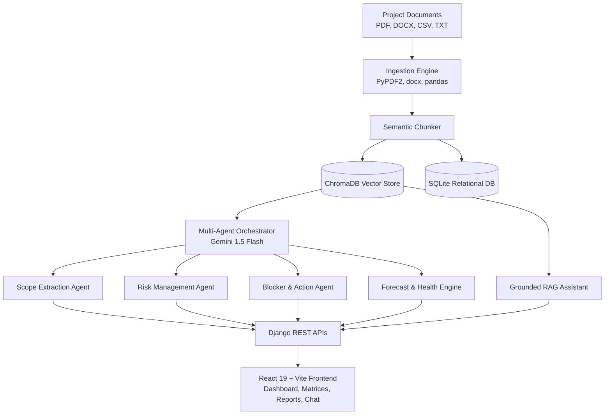

# AI Project Intelligence & Risk Advisor

[](https://github.com/pratikshau1/Infosys-Springboard-Virtual-Internship-7.0/actions/workflows/ci.yml)

An intelligent full-stack project-management platform that transforms scattered project documents into a living, queryable project intelligence layer.

The platform ingests project proposals, SRS documents, meeting notes, progress updates, and task lists, processing them through a **Vector RAG pipeline (ChromaDB)** and **Multi-Agent AI architecture (Gemini)** to extract project intelligence, identify risks, track blockers, forecast delivery challenges, calculate health scores, and answer project questions with source citations.

---

## 🏛️ System Architecture



---

## ✨ Core Features

1. **Multi-Format Ingestion**: Ingests PDF, DOCX, CSV, and TXT artifacts with automatic semantic chunking and ChromaDB vector indexing.
2. **Multi-Agent AI Extraction**:
   - **Scope Agent:** Extracts functional requirements, architecture definitions, and goals.
   - **Risk Agent:** Detects categories, severity (*Critical, Moderate, Low*), probability, impact, and recommends mitigations.
   - **Blocker Agent:** Tracks impediments, owners, priority, and affected deliverables.
   - **Sprint Action Item Agent:** Extracts actionable tasks, assignees, and deadlines.
3. **Deterministic Project Health Score (PRD §5.6)**:
   $$\text{Health Score} = (0.20 \times \text{Scope}) + (0.25 \times \text{Timeline}) + (0.20 \times \text{Blockers}) + (0.15 \times \text{Risks}) + (0.10 \times \text{Progress}) + (0.10 \times \text{Docs})$$
4. **Historical Sprint Trajectory**: Visualizes velocity trendlines across sprint checkpoints.
5. **Conversational RAG AI Assistant**: Conversational assistant citing exact source document excerpts and chunk IDs.
6. **Documentation Generator & Exports**: Synthesizes Executive Summaries, Risk Assessment Reports, and SRS Gap Analyses with one-click Markdown and CSV download.
7. **Multi-Project Management**: Switch between projects or create new project workspaces with isolated ChromaDB vector collections.
8. **Enterprise Aesthetics**: Minimalist dark-mode UI with crisp SVG vector icons (zero emojis).

---

## 🚀 Quick Start (Local Setup)

### 1. Prerequisites
- Python 3.11+
- Node.js 18+ & npm
- Git

### 2. Backend Setup
```bash
cd backend
python -m venv ../venv
# Windows:
..\venv\Scripts\activate
# Linux/macOS:
source ../venv/bin/activate

pip install -r requirements.txt
python manage.py migrate
python seed_demo.py
python manage.py runserver 127.0.0.1:8000
```

### 3. Frontend Setup
```bash
cd frontend
npm install
npm run dev
```
Open **[http://127.0.0.1:5173/](http://127.0.0.1:5173/)** in your browser.

---

## 🐳 Quick Start with Docker
```bash
cp .env.example .env
docker-compose up --build
```
- Frontend: `http://localhost:5173`
- Backend API: `http://localhost:8000/api/`

---

## 🧪 Running Tests
```bash
cd backend
python manage.py test intelligence
```

---

## 📂 Demo Artifacts
Use the ready-to-test documents inside `demo_artifacts/`:
- `System_Architecture_Proposal.txt`
- `Risk_Log.csv`
- `Sprint_Meeting_Minutes.txt`
